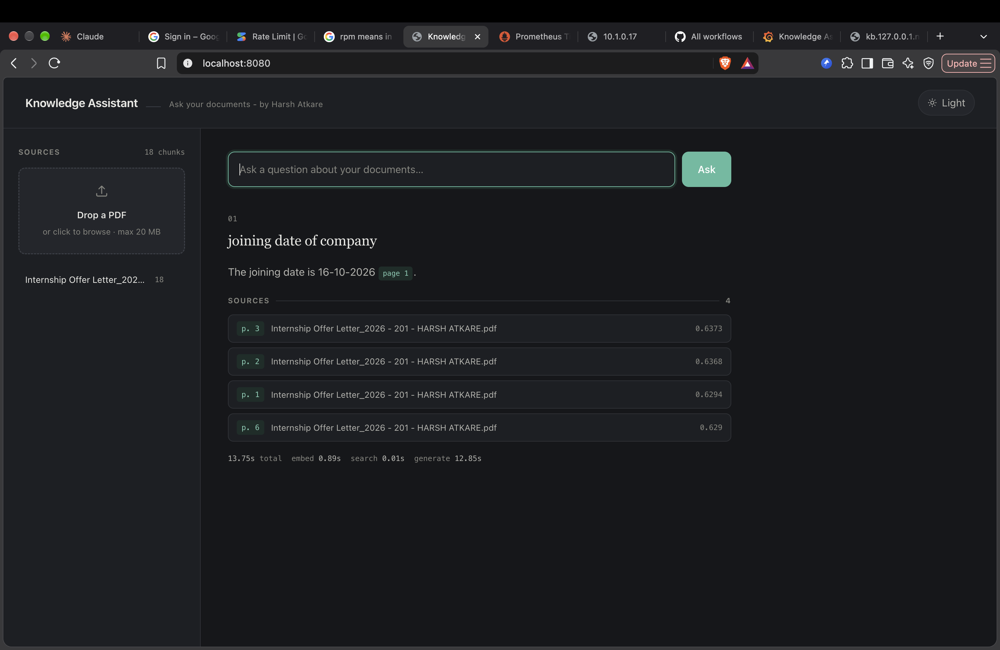
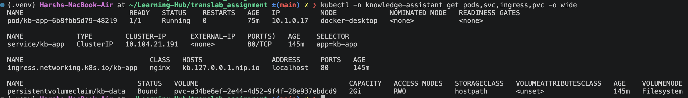
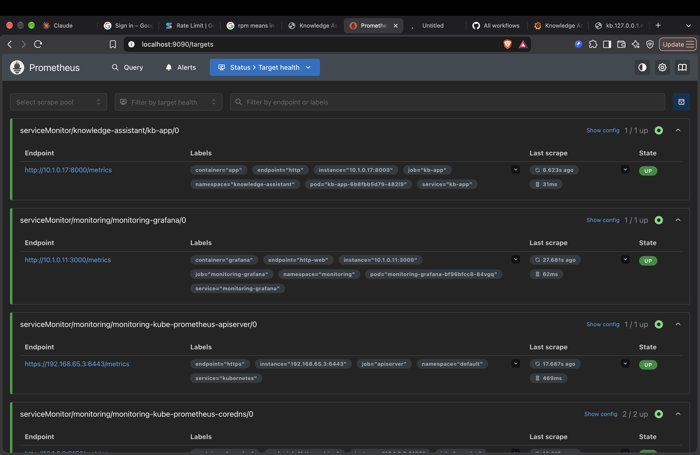
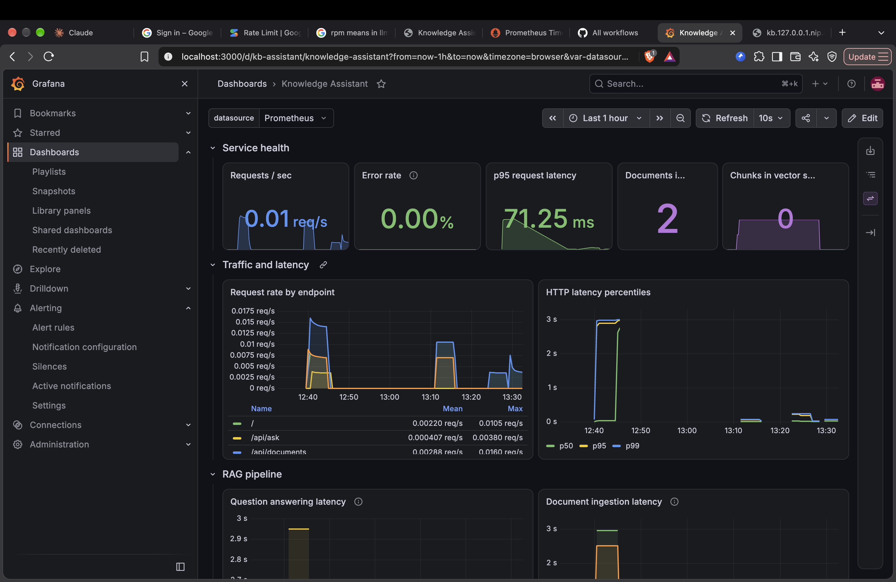
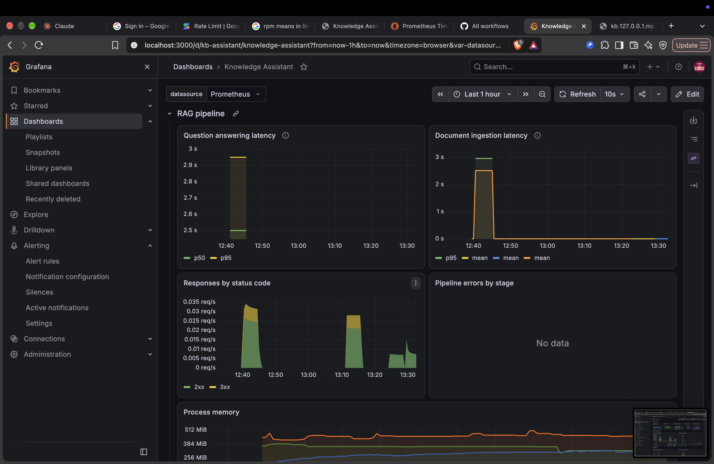
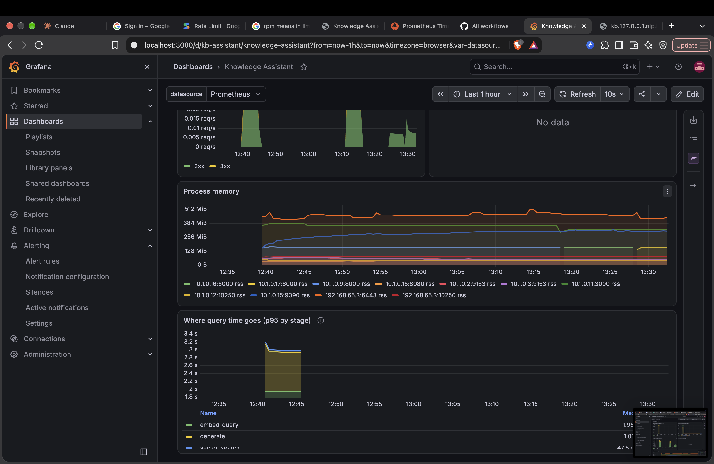
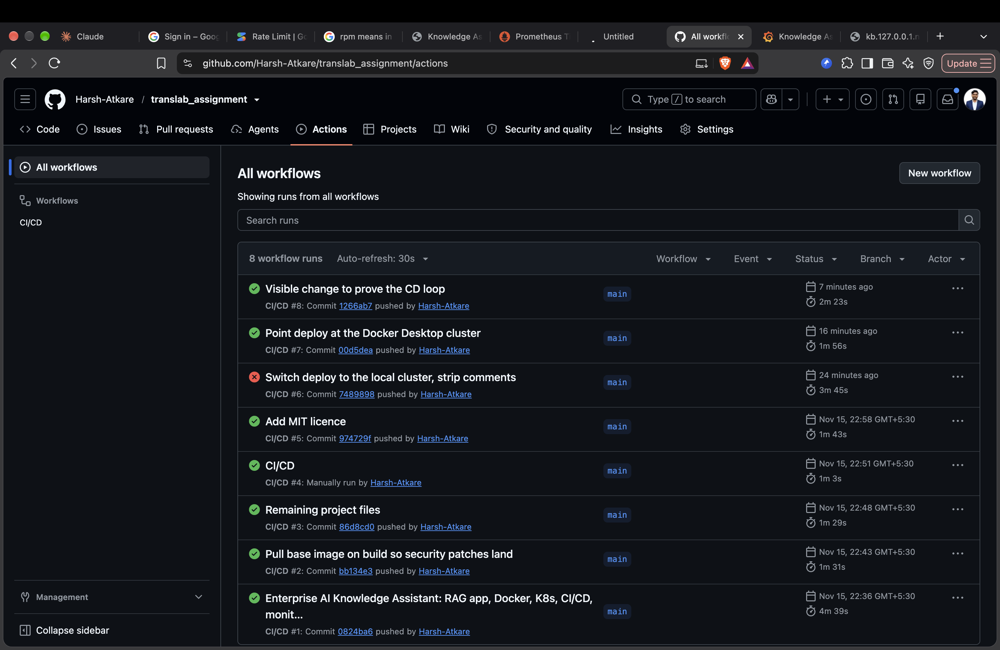

# Enterprise AI Knowledge Assistant

Upload PDF documents, ask questions in plain English, get answers grounded in
those documents with page citations.

A RAG application with a React frontend, containerised, deployed on
Kubernetes, with CI/CD, centralised logging and a Grafana dashboard.



---

## Assessment and deliverables

**Assessment:** functional demonstration; source code review; architecture
explanation; deployment verification; monitoring dashboard review; technical
presentation.

**Deliverables:** working application, Git repository, README, Dockerfile,
Kubernetes manifests, CI/CD pipeline configuration, Grafana dashboard,
technical presentation.

| Deliverable | Where |
|---|---|
| Working application | `app/`, `frontend/` |
| Git repository | this repo |
| README | this file |
| Dockerfile | `Dockerfile` — three-stage build |
| Kubernetes manifests | `k8s/` |
| CI/CD pipeline | `.github/workflows/ci-cd.yml` |
| Grafana dashboard | `monitoring/dashboards/knowledge-assistant.json` |
| Technical presentation | submitted separately |

---

## How it works

1. A PDF is uploaded. Text is extracted page by page, cleaned, and split into
   overlapping chunks of ~1200 characters.
2. Each chunk is embedded with Gemini and stored in ChromaDB with its page
   number and source filename.
3. A question is embedded, the four closest chunks are retrieved by cosine
   similarity, and those plus the question go to Gemini.
4. The answer comes back citing the pages it used, with the retrieved
   passages and a per-stage timing breakdown.

```
                    ┌──────────────────────────┐
  React 18 + Vite   │  FastAPI  (app/main.py)  │
  (served by        │  ├─ /api/documents       │
   FastAPI) ──────► │  ├─ /api/ask             │
                    │  ├─ /healthz  /readyz    │
                    │  └─ /metrics             │
                    └────┬────────────────┬────┘
                         │                │
               ┌─────────▼──────┐   ┌─────▼──────────┐
               │   PyMuPDF      │   │  Gemini API    │
               │   extract +    │   │  embeddings +  │
               │   chunk        │   │  generation    │
               └─────────┬──────┘   └─────┬──────────┘
                         │                │
                    ┌────▼────────────────▼────┐
                    │  ChromaDB (persistent)   │
                    │  vectors + page metadata │
                    └──────────────────────────┘

  Observability:  stdout JSON logs ──► Promtail ──► Loki ──► Grafana
                  /metrics          ──► Prometheus ───────► Grafana
```

| Layer | Choice |
|---|---|
| API | FastAPI |
| Frontend | React 18 + Vite, light and dark themes |
| PDF | PyMuPDF |
| Embeddings | Gemini `gemini-embedding-2` |
| Vector store | ChromaDB, embedded |
| LLM | Gemini Flash |
| Metrics | Prometheus + Grafana |
| Logs | structured JSON to stdout |

---

## Prerequisites

- Python 3.12+, Node 22+
- Docker Desktop, with **Kubernetes enabled** (Settings → Kubernetes)
- A Gemini API key — free, no credit card:
  <https://aistudio.google.com/app/apikey>

---

## The API key

Everything reads the key from one place: `.env`, which is gitignored and
never enters the image or the repository.

```bash
cp .env.example .env
# paste the key after GEMINI_API_KEY=
```

| Running | How the key gets there |
|---|---|
| Local | `load_dotenv()` reads `.env` at startup |
| Docker | compose passes it with `env_file: .env` |
| Kubernetes | `make k8s-secret` creates a Secret from `.env` (runs inside `make k8s-deploy`) |

`k8s/secret.example.yaml` shows the shape of the Secret but is never applied —
a real key would be committed if it were. `make env-check` prints the config
the running app actually has, with the key masked.

---

## 1. Run locally

```bash
make venv        # python deps + npm install + vite build
make run         # http://localhost:8000
make test        # 64 tests, no network calls
```

`make models` lists the Gemini models your key can reach. `make ui-dev` runs
Vite on :5173 with hot reload.

## 2. Run with Docker

The image is built in three stages: Node compiles the React bundle, a Python
stage builds wheels, and the runtime image copies in the artefacts from both.
Neither toolchain ships — no compilers, no npm, no `node_modules`. It runs as
a non-root user with dropped capabilities.

```bash
make up          # app :8000 · prometheus :9090 · grafana :3000 (admin/admin)
make logs
make down
```

| Changed | Command |
|---|---|
| `.env` only | `make restart` |
| Code or frontend | `make rebuild` |

## 3. Deploy on Kubernetes

Docker Desktop's Kubernetes shares the Docker daemon, so a locally built
image is visible to the cluster with no registry step.

```bash
kubectl config use-context docker-desktop

make build
make k8s-deploy      # namespace, secret, configmap, pvc, deployment, service, ingress
make k8s-status
make k8s-forward     # app :8080 · prometheus :9090 · grafana :3000
```



| Manifest | What it does |
|---|---|
| `namespace.yaml` | Isolates everything in `knowledge-assistant` |
| `configmap.yaml` | Non-secret config — models, chunking, throughput |
| `secret.example.yaml` | Template; the real Secret comes from `.env` |
| `pvc.yaml` | 2 Gi volume for the Chroma index |
| `deployment.yaml` | 1 replica, non-root, startup/liveness/readiness probes |
| `service.yaml` | ClusterIP on port 80 |
| `ingress.yaml` | nginx, 20 MB body limit for uploads |
| `servicemonitor.yaml` | Prometheus scrape target |

**One replica, by design.** ChromaDB's embedded mode is a single-writer
SQLite file on a ReadWriteOnce volume — a second pod would corrupt it, which
is also why the deployment uses `Recreate` rather than a rolling update.
Scaling out means Chroma in server mode or a hosted vector database.

**Probes.** Liveness hits `/healthz`, which does no I/O — if it touched
Chroma or Gemini, a slow dependency would kill the pod and make an outage
worse. Readiness hits `/readyz`, which does check them. A startup probe runs
first so a cold index does not get the pod killed mid-boot.

Deleting the pod and watching documents survive the restart demonstrates the
PVC is doing its job.

## 4. Monitoring

```bash
helm install monitoring prometheus-community/kube-prometheus-stack \
  -n monitoring --create-namespace -f monitoring/prometheus-values.yaml

kubectl apply -f k8s/servicemonitor.yaml
make k8s-dashboard   # loads the dashboard as a labelled ConfigMap
```



Thirteen panels: request rate, error rate, p95 latency, documents and chunks
indexed, request rate by endpoint, latency percentiles, question-answering
and ingestion latency, responses by status, pipeline errors, memory, and a
stacked breakdown of where query time goes.





| Custom metric | Meaning |
|---|---|
| `kb_ingest_duration_seconds` | Parse + embed + index one PDF |
| `kb_query_duration_seconds` | Question to answer, end to end |
| `kb_stage_duration_seconds{stage}` | Query split into embed / search / generate |
| `kb_chunks_indexed_total` | Chunks written to the store |
| `kb_documents_total` | Documents currently indexed |
| `kb_errors_total{stage}` | Failures by pipeline stage |

Every log line is JSON on stdout carrying a `request_id`, also returned in
the `X-Request-ID` header, so one request can be traced end to end:

```logql
{namespace="knowledge-assistant"} | json | request_id="a1b2c3d4e5f6"
```

## 5. CI/CD



| Job | Runs on | Does |
|---|---|---|
| `test` | GitHub | ruff lint, Vite build, pytest with coverage |
| `validate-manifests` | GitHub | kubeconform against the Kubernetes schema |
| `build` | GitHub | Builds and publishes the image to GHCR |
| `deploy` | self-hosted | Builds, rolls out the cluster, health-checks it |

The cluster runs in Docker Desktop on a developer machine, which GitHub's
hosted runners cannot reach — they are on the public internet, the machine is
behind NAT. The deploy job therefore runs on a **self-hosted runner** on the
same machine as the cluster: no inbound access, no kubeconfig secret, no
tunnel.

```
git push ─► GitHub ─► lint, test, manifests, image   (hosted runners)
               │
               └────► deploy                          (runner on the dev machine)
                          └─► build · set image · rollout · health check
```

Setup is in `docs/self-hosted-runner.md`. The trade-off: the runner and the
cluster both have to be up. For a team you would target a cloud cluster with
a `KUBE_CONFIG` secret, or move to pull-based GitOps with Argo CD or Flux so
the cluster reconciles itself and nothing external holds credentials.

---

## API

| Method | Path | Purpose |
|---|---|---|
| `POST` | `/api/documents` | Upload and index a PDF |
| `GET` | `/api/documents` | List indexed documents |
| `DELETE` | `/api/documents/{id}` | Remove a document and its chunks |
| `POST` | `/api/ask` | Ask a question |
| `GET` | `/api/info` | Current config and index size |
| `GET` | `/healthz` `/readyz` | Liveness and readiness |
| `GET` | `/metrics` | Prometheus exposition |
| `GET` | `/docs` | Swagger UI |

---

## Configuration

Everything is an environment variable; see `.env.example`. In Kubernetes the
non-secret values come from `k8s/configmap.yaml`.

| Variable | Default | Notes |
|---|---|---|
| `GEMINI_API_KEY` | — | Required |
| `GEMINI_MODEL` | `gemini-3.5-flash` | `make models` lists what your key can reach |
| `GEMINI_EMBED_MODEL` | `gemini-embedding-2` | Must match `EMBED_DIM` |
| `EMBED_DIM` | `768` | Changing this invalidates the existing index |
| `CHUNK_SIZE` / `CHUNK_OVERLAP` | `1200` / `200` | Characters |
| `TOP_K` | `4` | Chunks sent to the model as context |
| `EMBED_CONCURRENCY` / `EMBED_RPM` | `8` / `90` | Embedding throughput and rate ceiling |
| `MAX_OUTPUT_TOKENS` | `2048` | Generation budget |
| `THINKING_BUDGET` | `0` | Reasoning tokens; `auto` lets the model decide |
| `REQUEST_TIMEOUT` | `120` | Seconds, per Gemini call |
| `MAX_UPLOAD_MB` | `20` | Must stay ≤ the ingress body limit |

Changing the **embedding model or dimension** invalidates the index — the app
detects the mismatch and refuses to serve it rather than returning nothing.
Run `make reset` (local) or `make k8s-reset` (cluster), then re-upload.

**Thinking models.** Gemini 2.5 and 3.x reason internally before writing, and
that reasoning is charged against `max_output_tokens`. With a small budget
the model can consume all of it thinking and return no text at all, slowly.
`THINKING_BUDGET=0` turns it off, which is right here: the answer already
sits in the retrieved passages.

---

## Design decisions

- **Grounding over fluency.** Three layers stop hallucination: the prompt
  forbids answering outside the supplied context, temperature is 0.2, and any
  query whose best match scores below 0.25 is refused before the model is
  called.
- **1200-character chunks with 200 overlap.** Roughly 300 tokens: enough to
  hold a complete idea, small enough that four fit in context without
  diluting the relevant part. The overlap stops a sentence spanning a
  boundary being lost by both chunks.
- **Cosine similarity**, because Gemini embeddings are normalised.
- **Page numbers travel with every chunk** — without them the citations
  would be decorative.
- **Fail loudly.** Mismatched embedding models, empty model responses, wrong
  vector counts and upstream errors all surface with an actionable message
  rather than a stack trace or a blank screen.
- **No retries on upstream failures.** Google's 503 spikes outlast any
  sensible backoff, a daily quota lasts 22 hours, and a 404 is permanent —
  retrying would add 30 seconds to the same failure.
- **Pinned dependencies and `npm ci`** so a build today and a build in six
  months produce the same image.

---

## Known limitations

- **No authentication.** Anyone who can reach the service can upload and query.
- **Single replica.** See the Kubernetes section.
- **Scanned PDFs are rejected** — there is no OCR.
- **Free-tier quotas.** Gemini's free tier allows as few as 20 generations
  per day per model, and its models sometimes run out of capacity (503).
- **No TLS, no image scanning, no index backups.**
- **Deployment depends on a laptop** — the self-hosted runner and the cluster
  both have to be up.

Next would be authentication, OCR, a reranker between retrieval and
generation, streamed responses, and Chroma in server mode so the deployment
can scale past one replica.

---

## Project layout

```
app/              FastAPI application
  rag/            PDF parsing, chunking, embeddings, vector store, pipeline
  routes/         documents, chat, health
frontend/src/     React components, hooks, API client
tests/            64 tests, Gemini stubbed throughout
k8s/              Kubernetes manifests
monitoring/       Prometheus, Grafana and Loki config + dashboard JSON
scripts/          list_models, env-check, doctor, load generator
docs/             self-hosted runner setup, screenshots
.github/          CI/CD pipeline
```

`make help` lists every command.

---

## Pushing changes

```bash
make test                    # 64 tests
make lint

git add -A
git commit -m "Describe the change"
git push
```

That triggers the pipeline: lint and tests, manifest validation, image
publish, then a rollout to the cluster with a health check gating success.
Watch it under **Actions**, and confirm the result with:

```bash
kubectl -n knowledge-assistant get pods
kubectl -n knowledge-assistant describe deployment kb-app | grep Image:
```

The image tag is the commit SHA, so a running pod traces back to a commit.
